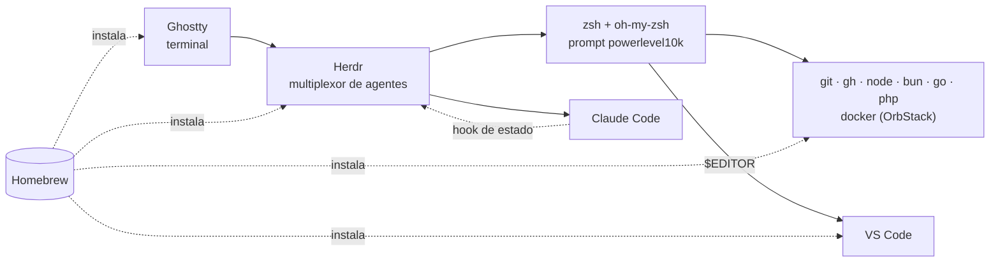

---
hide:
  - toc
---

# Mi entorno de desarrollo

Este sitio documenta mi entorno de desarrollo en macOS (Apple Silicon) pieza por pieza: qué es cada herramienta, para qué la uso y cómo se conectan entre sí. El repositorio que lo acompaña lo replica en una Mac nueva con un solo comando: `./install.sh`.

## El setup de un vistazo

<div class="grid cards" markdown>

-   :material-console:{ .lg .middle } **Terminal**

    ---

    **Ghostty** es la terminal: rápida, nativa de macOS y configurada con un archivo de texto. Encima corre **Herdr**, un multiplexor que mantiene varias sesiones de agentes de IA abiertas y muestra en qué está cada una.

    [:octicons-arrow-right-24: Terminal](terminal.md)

-   :material-bash:{ .lg .middle } **Shell**

    ---

    **zsh** con **oh-my-zsh** y siete plugins: sugerencias del historial, colores de sintaxis, búsqueda con flechas y avisos de aliases. El prompt es **powerlevel10k** en estilo Pure. Trae aliases y funciones propias (`gmain`, `genpass`, `cleanup`).

    [:octicons-arrow-right-24: Shell](shell.md)

-   :material-microsoft-visual-studio-code:{ .lg .middle } **Editor**

    ---

    **VS Code** con 13 extensiones (web, bases de datos, archivos de configuración y contenedores) y un `settings.json` mínimo. También es el `$EDITOR` del shell: git abre ahí los mensajes de commit.

    [:octicons-arrow-right-24: Editor](editor.md)

-   :material-palette:{ .lg .middle } **Fuentes y colores**

    ---

    Una sola fuente, **IosevkaTerm Nerd Font**, y un solo tema, **Catppuccin Frappé**, en todas las apps. Este sitio usa la misma paleta.

    [:octicons-arrow-right-24: Fuentes y colores](fonts-and-colors.md)

-   :material-package-variant:{ .lg .middle } **Apps y paquetes**

    ---

    Todo se instala con **Homebrew**: runtimes (node, bun, go, php), herramientas de bases de datos, **OrbStack** para Docker y, de forma opcional, mis apps personales y de la App Store.

    [:octicons-arrow-right-24: Apps y paquetes](apps.md)

-   :material-robot-outline:{ .lg .middle } **Claude Code**

    ---

    El asistente de programación que uso en la terminal, con mis reglas globales (`CLAUDE.md`): respuestas directas, trabajo por Epics y Tickets, commits convencionales y nunca hacer push solo.

    [:octicons-arrow-right-24: Claude Code](claude-code.md)

</div>

**Git** completa el setup: un `.gitconfig` corto que incluye `~/.gitconfig.local`, donde vive tu identidad (nombre y email). Así tu identidad nunca termina en el repositorio. [:octicons-arrow-right-24: Git](git.md)

## Cómo encaja todo



- **Ghostty** abre la ventana, **Herdr** la divide en sesiones y cada sesión corre **zsh** o **Claude Code**.
- Claude Code le avisa a Herdr si está trabajando, esperando o terminó, mediante un hook que instala el propio Herdr. Así ves el estado de cada agente sin cambiar de sesión.
- Desde zsh usas los runtimes y herramientas que instaló Homebrew. `docker` y `docker compose` vienen de OrbStack, no de Homebrew.
- Cuando una herramienta necesita un editor (git, `crontab -e`…), abre VS Code y espera a que cierres el archivo.
- La fuente y el tema son los mismos en Ghostty, Herdr y VS Code, así que todo se ve igual.

## Principios del repositorio

| Principio | Qué significa |
|---|---|
| **Un comando** | `git clone` + `./install.sh` deja la Mac lista. Lo que no se puede automatizar (aceptar el diálogo de Xcode, tu contraseña) te lo pide en el momento |
| **Se puede repetir** | Cada paso revisa qué ya está hecho y lo salta. Correrlo dos veces no cambia nada |
| **Nunca pierdes nada** | Antes de reemplazar un archivo tuyo, guarda una copia en `~/.dotfiles-backup/<fecha>/` |
| **Copias, no symlinks** | Los archivos se copian de `home/` a tu `$HOME`. Tu Mac no depende de dónde clonaste el repo |
| **Sin secretos** | Llaves SSH, historial, tokens y tu identidad de git nunca entran al repo |
| **No toca macOS** | No cambia preferencias del sistema (`defaults write`). Solo instala herramientas y copia sus configuraciones |
| **Solo Apple Silicon** | En Intel, Linux, Rosetta o como `root`, se detiene con un mensaje claro antes de hacer nada |

Para modificar el setup (agregar archivos, paquetes o pasos) y correr los tests: [:octicons-arrow-right-24: Cómo funciona el repo](repository.md)

## Qué no incluye

- **Preferencias de macOS:** Dock, Finder, teclado, etc.
- **Datos privados:** `~/.ssh`, `~/.claude.json`, historiales, sesiones.
- **Apps que dejé fuera a propósito:** por ejemplo LM Studio, porque para IA solo uso Claude Code.
- **Skills y plugins de Claude Code:** se sincronizan desde tu cuenta de claude.ai.

## Pruébalo

```bash
git clone https://github.com/theoneandonlyjohnny/dev_setup.git
cd dev_setup
./install.sh --dry-run   # muestra todo lo que haría, sin cambiar nada
```

Requisitos, opciones, qué hace cada paso y cómo restaurar backups: [:octicons-arrow-right-24: Instalación](install.md)
