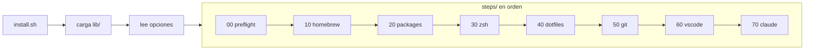

# Cómo funciona el repo

Esta página es para modificar el setup: agregar archivos, paquetes o pasos, correr los tests y publicar este sitio.

## Estructura

| Ruta | Contenido |
|---|---|
| `install.sh` | Punto de entrada: carga `lib/`, lee las opciones y corre los pasos en orden |
| `steps/` | Un archivo por paso (`NN-nombre.sh`), en orden numérico |
| `lib/` | Funciones compartidas: mensajes (`log.sh`), opciones, copia con backup y `--dry-run` (`utils.sh`) |
| `home/` | Espejo de `$HOME`: los archivos que se copian a tu Mac |
| `manifest.txt` | Qué archivos de `home/` copia el paso `dotfiles` |
| `manifest.claude.txt` | Los de Claude Code, que copia el paso `claude` (así `--skip claude` los deja intactos) |
| `Brewfile`, `Brewfile.full` | Paquetes core y personales |
| `vscode/extensions.txt` | Extensiones de VS Code |
| `scripts/` | Herramientas del repo: `deploy-docs.sh` publica este sitio |
| `tests/` | Tests ([bats](https://github.com/bats-core/bats-core)) |
| `docs/`, `mkdocs.yml` | Este sitio |

## Cómo corre la instalación



- Cada paso corre en su propio subshell con `set -euo pipefail`. Si falla, `install.sh` dice cuál y se detiene.
- El nombre del paso es el del archivo sin número: `steps/30-zsh.sh` → `zsh`. Es el que usa `--skip`.
- Cada paso es **idempotente**: primero revisa si ya está hecho y, si es así, lo salta.
- Todo lo que cambia algo pasa por `run_cmd`, que con `--dry-run` solo imprime el comando.

## Sentido único: `home/` → `$HOME`

Los archivos se editan **solo en `home/`**. El setup los copia a tu Mac y nunca copia nada de vuelta. Si cambias algo directo en tu Mac (por ejemplo, desde los ajustes de VS Code), cópialo a `home/` para que quede en el repo.

Algunos archivos del repo son versiones limpias que difieren a propósito de los de la Mac del autor: sin rutas personales, sin secretos y sin restos de herramientas que ya no están instaladas.

## Agregar cosas

### Un archivo de configuración

1. Ponlo en `home/` con la misma ruta que tendrá en `$HOME`. Ejemplo: `~/.config/foo/config.toml` → `home/.config/foo/config.toml`.
2. Agrega la ruta, relativa a `$HOME`, a `manifest.txt`: `.config/foo/config.toml`.
3. Documéntalo en la página que corresponda de `docs/`. Si muestras el archivo completo, usa un bloque de código con su ruta como título (```` ```toml title="~/.config/foo/config.toml" ````): un test revisa que sea idéntico al de `home/`.

Los tests fallan si un archivo de `home/` no está en el manifest, o al revés.

!!! danger "Nunca versiones secretos"
    Nada de `~/.ssh`, tokens, historiales ni `~/.claude.json`. `.gitignore` bloquea los más comunes, pero revisa cada archivo antes de agregarlo.

### Un paquete o app

Agrega una línea a `Brewfile` (core) o `Brewfile.full` (personal). Ver [Apps y paquetes](apps.md#agregar-o-quitar-algo).

### Una extensión de VS Code

Agrega su ID a `vscode/extensions.txt`. Ver [Editor](editor.md#extensiones).

### Un paso nuevo

Crea `steps/NN-nombre.sh`. El número define el orden. El paso:

- Se carga con `source` dentro de un subshell: no lleva `#!` ni llama a `exit` cuando todo sale bien.
- Usa las funciones de `lib/` (`log_*`, `run_cmd`, `command_exists`, `confirm`…) en vez de reimplementarlas.
- Lee las opciones directamente: `FULL`, `DRY_RUN`, `ASSUME_YES`.
- Es idempotente y respeta `--dry-run`.
- Es compatible con bash 3.2 (el de macOS): sin `mapfile` ni arrays asociativos.
- Tiene su test en `tests/<nombre>.bats`.

## Tests y lint

```bash
bats tests/                                  # tests
shellcheck install.sh lib/*.sh steps/*.sh scripts/*.sh   # lint
```

Los dos vienen en `Brewfile`. No hay CI: córrelos antes de cada commit.

| Test | Qué revisa |
|---|---|
| `repo.bats` | El manifest coincide con `home/`; no hay rutas `/Users/…`; los archivos de zsh y Ghostty son válidos; `docs/claude-code.md` explica cada regla y cada clave; cada página de `docs/` está en el menú del sitio; los bloques de código con título `~/<ruta>` son idénticos al archivo de `home/` |
| `install.bats` | Opciones, orden de pasos y `--skip`, con pasos de prueba |
| `lib.bats` | Las funciones de `lib/` |
| `<paso>.bats` | Cada paso, con comandos del sistema (`brew`, `uname`…) simulados |
| `deploy-docs.bats` | `scripts/deploy-docs.sh`, con `python3`, `pip` y `mkdocs` simulados |

Los tests nunca instalan nada ni tocan tu `$HOME`: simulan los comandos del sistema y trabajan en carpetas temporales.

## Este sitio

El sitio usa [MkDocs](https://www.mkdocs.org) con [Material for MkDocs](https://squidfunk.github.io/mkdocs-material/). Cada página es un `.md` de `docs/`, y el menú se define en `mkdocs.yml`.

### Preparar

Una sola vez, en un entorno virtual de Python dentro del repo (`.venv/`, ignorado por git):

```bash
python3 -m venv .venv
.venv/bin/pip install -r requirements-docs.txt
```

### Editar y previsualizar

```bash
.venv/bin/mkdocs serve           # http://127.0.0.1:8000/dev_setup/, se recarga al guardar
.venv/bin/mkdocs build --strict  # falla si hay links o anclas rotas
```

- Página nueva: agrégala al `nav` de `mkdocs.yml`, una por línea. Un test lo revisa.
- Links entre páginas: relativos al `.md` (`[Shell](shell.md)`). Funcionan en el sitio y en GitHub.
- Material muestra un aviso sobre MkDocs 2.0 en cada comando. No afecta: la versión fijada exige MkDocs 1.x. Para ocultarlo, antepón `NO_MKDOCS_2_WARNING=true`.

### Publicar

```bash
./scripts/deploy-docs.sh            # publica
./scripts/deploy-docs.sh --dry-run  # solo construye; no sube nada
```

El script:

1. Se detiene si hay cambios sin commit en `docs/`, `mkdocs.yml` o `requirements-docs.txt`: el sitio publicado debe coincidir con el repo.
2. Crea `.venv/` si no existe e instala `requirements-docs.txt`.
3. Construye con `--strict`. Si hay un link roto, se detiene.
4. Corre `mkdocs gh-deploy --force`, que sube el sitio a la rama `gh-pages` (hace push). El sitio queda en https://theoneandonlyjohnny.github.io/dev_setup/ en uno o dos minutos.

La primera vez, en GitHub: **Settings → Pages → Build and deployment → Deploy from a branch → `gh-pages` / `(root)`**.
